# Mini OS Kernel Simulator

A miniature operating-system kernel simulator written in Rust. It models the
core responsibilities of an OS kernel — process management, CPU scheduling,
memory management, synchronization, IPC, and deadlock handling — as a
deterministic, tick-based discrete-event simulation you drive from a terminal.

**This is an educational simulator, not a bootable OS.** Simulated processes
are data structures advanced by ticks, not real threads. Real OS threads are
used in exactly one place: the synchronization demos, where showing genuine
concurrency is the point.

The terminal UI is colorized — per-pid colored Gantt charts, state-colored
tables, usage bars, verdict-colored deadlock results. Colors auto-disable
when output is piped or `NO_COLOR` is set; Windows VT mode is enabled
automatically.

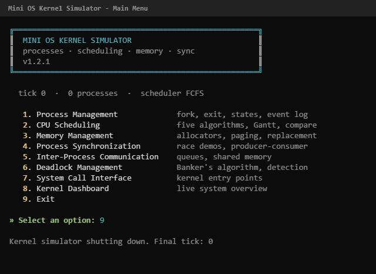

## Screenshots

Real captured sessions: every PNG below is rendered from an actual terminal
transcript produced by the committed capture script
(`scripts/capture-screenshots.ps1`: scripted input → real binary with ANSI
colors → HTML → headless Chrome screenshot), so the shots are reproducible.

| SRTF scheduling | Algorithm comparison |
|---|---|
| 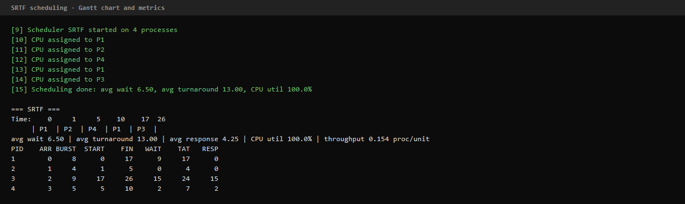 | 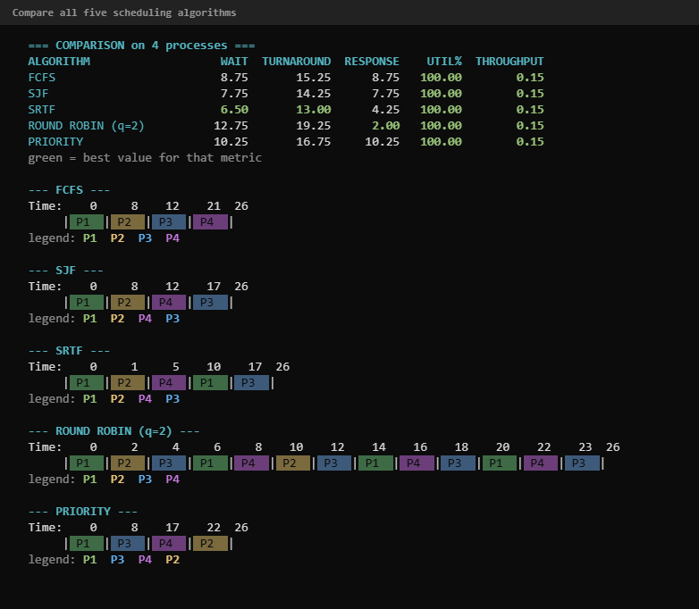 |

| Banker's Algorithm | Kernel dashboard |
|---|---|
| 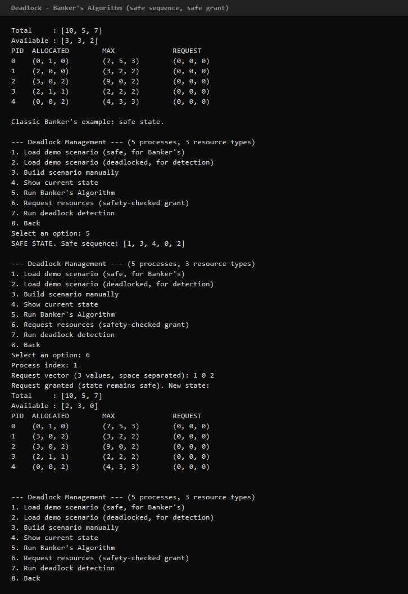 | 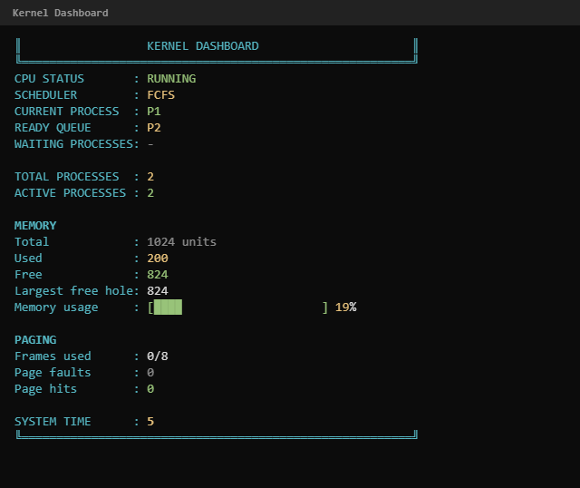 |

<details>
<summary>More screenshots: process table, memory map, paging, sync, IPC, detection</summary>

| | |
|---|---|
| 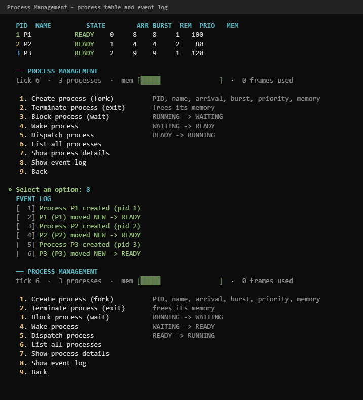 | 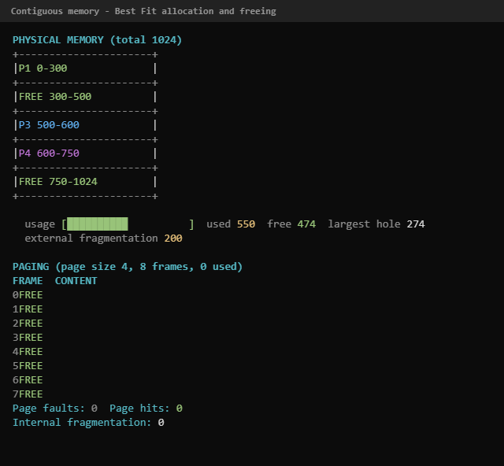 |
| 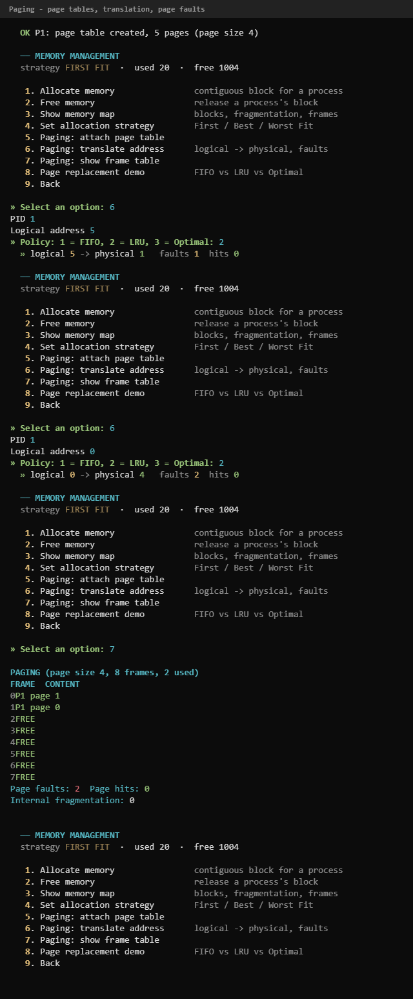 | 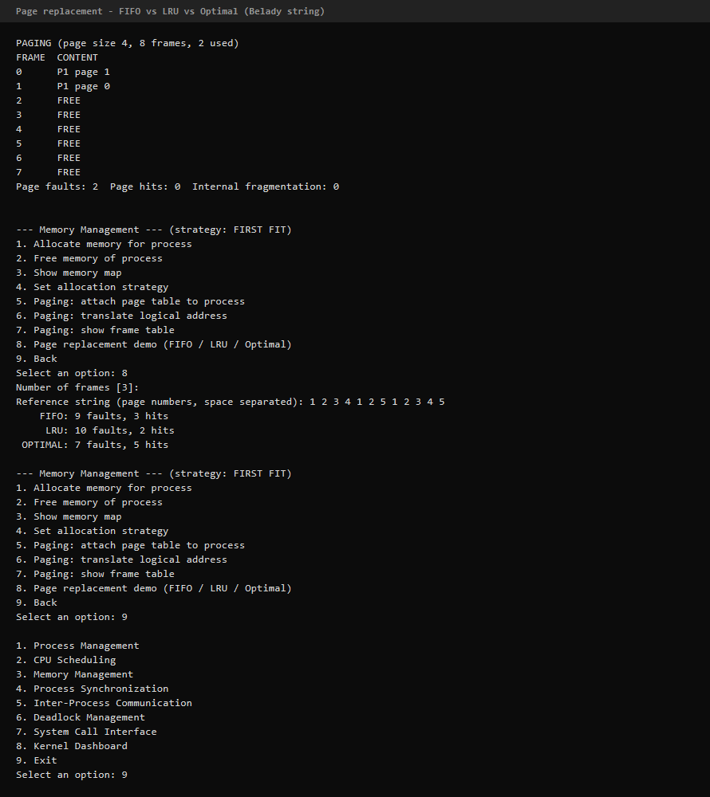 |
| 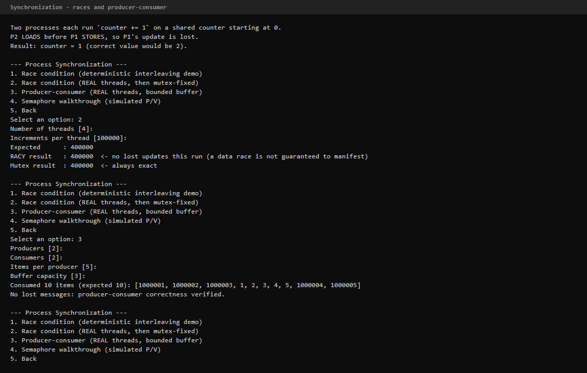 | 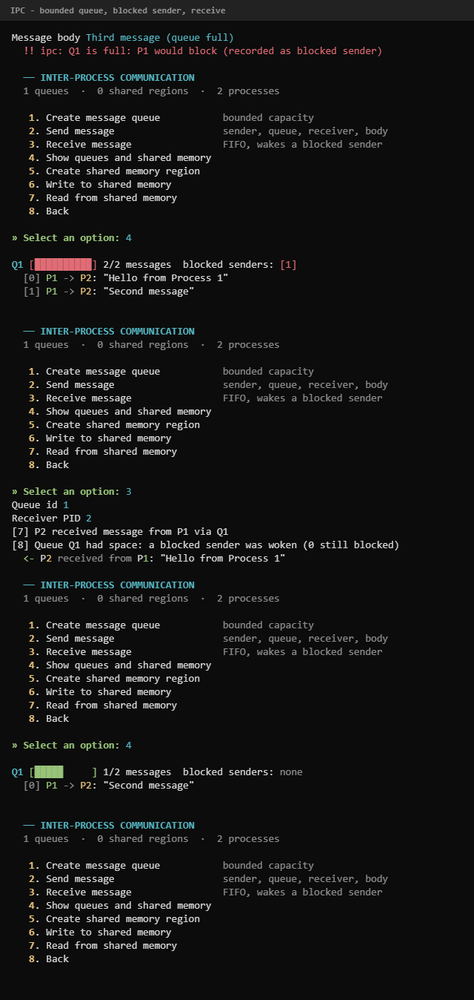 |
| 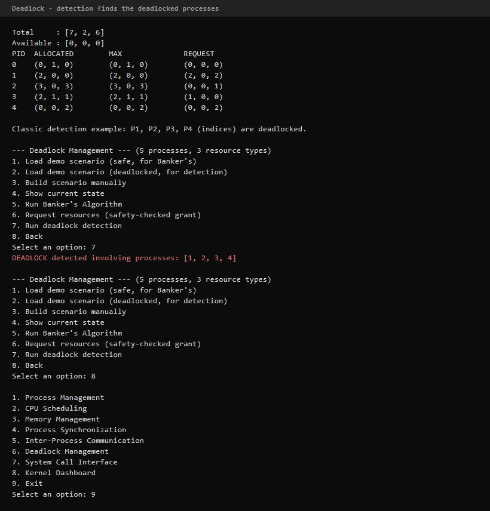 | |

</details>

## Install

```sh
# npm (Node 16+; Rust auto-detected, see docs/INSTALL.md)
npm install -g mini-os-kernel-simulator   # or: npx mini-os-kernel-simulator

# cargo
cargo install --git https://github.com/Gunjan00001/Mini-OS-Kernel-Simulator.git --locked mini-os-kernel

# one-liner scripts
curl -fsSL https://raw.githubusercontent.com/Gunjan00001/Mini-OS-Kernel-Simulator/main/install.sh | bash        # macOS / Linux
irm https://raw.githubusercontent.com/Gunjan00001/Mini-OS-Kernel-Simulator/main/install.ps1 | iex               # Windows

# docker
docker build -t mini-os-kernel . && docker run -it --rm mini-os-kernel

# from source
git clone https://github.com/Gunjan00001/Mini-OS-Kernel-Simulator.git
cd Mini-OS-Kernel-Simulator && cargo run --release
```

Then run `mini-os-kernel` (or `cargo run`). Every option is in
[`docs/INSTALL.md`](docs/INSTALL.md).

## Build and test (from a clone)

```sh
cargo run --release
cargo test          # 73 tests
cargo doc --open --no-deps   # API reference generated from the source comments
```

Zero external dependencies — the whole simulator is standard library only.

## Source documentation

The code is written to be read during review:

- every module starts with a `//!` header stating its responsibility and the
  invariants it relies on;
- public structs, fields and functions carry rustdoc comments;
- the scheduling, paging, allocator and deadlock code has inline comments at
  the non-obvious steps (tie-breaking, coalescing, eviction bookkeeping,
  rollback);
- `docs/architecture.md` and `docs/algorithms.md` give the high-level tour.

`cargo doc --open --no-deps` builds a browsable API reference from those
comments.

## Versioning and logs

- Releases use `major.minor.bugs` (third number counts bug-fix releases).
- [`CHANGELOG.md`](CHANGELOG.md) — per-release changes.
- [`docs/DEVELOPMENT_LOG.md`](docs/DEVELOPMENT_LOG.md) — chronological
  what/why log, failures included.


## Modules

| Menu | Module | What it shows |
|---|---|---|
| 1 | Process Management | fork/exit/wait/wake, process table, validated state machine (NEW → READY → RUNNING → WAITING/TERMINATED), event log |
| 2 | CPU Scheduling | FCFS, SJF, SRTF, Round Robin, Priority; Gantt chart, wait/turnaround/response/CPU-util/throughput, side-by-side comparison |
| 3 | Memory Management | First/Best/Worst Fit contiguous allocation with coalescing; paging with page tables, logical→physical translation, FIFO/LRU/Optimal replacement |
| 4 | Synchronization | race conditions (deterministic interleaving + real threads with a genuine data race), producer-consumer with Mutex+Condvar, semaphore P/V walkthrough |
| 5 | IPC | bounded message queues (full → blocked senders), shared memory regions with bounds checking |
| 6 | Deadlock | Banker's Algorithm (avoidance with safe sequence), deadlock detection, safety-checked resource requests |
| 7 | System Calls | fork_process, exit_process, wait_process, allocate_memory, free_memory, send_message, receive_message — all validated and logged centrally |
| 8 | Kernel Dashboard | CPU status, scheduler, current process, ready/waiting queues, memory totals, page faults, system time |

Every kernel operation is written to a centralized event log with simulation
ticks: `[12] CPU assigned to P2`.

## 10-minute demo walkthrough (viva script)

1. **Process Management (1)** — Create `P1..P4` with different arrival times,
   bursts, priorities, and memory needs (e.g. bursts 8/4/9/5, arrivals
   0/1/2/3). Show the process table and event log. Try `wait` on a READY
   process — the kernel rejects the illegal transition.
2. **CPU Scheduling (2)** — Run FCFS, SJF, SRTF, RR (q=2), Priority on the
   same workload; note SRTF preempting P1, then use *Compare all* to show
   SRTF has the lowest average waiting time. Show the Gantt chart.
3. **Memory (3)** — Allocate blocks to the processes, free one, switch
   strategy to Best Fit and re-allocate; show the memory map. Attach a page
   table to P1, translate logical address 5 (page fault), translate again
   (hit). Run the replacement demo on reference string
   `1 2 3 4 1 2 5 1 2 3 4 5` with 3 frames: FIFO 9 faults, LRU 10, Optimal 7.
4. **Synchronization (4)** — Run the interleaving race (lost update), the
   real-thread race (racy count < 80,000, mutex count = 80,000), and the
   producer-consumer demo (no lost messages).
5. **IPC (5)** — Create a queue with capacity 2, have P1 send 3 messages —
   the third send is rejected and P1 is recorded as a blocked sender; P2
   receives messages in FIFO order.
6. **Deadlock (6)** — Load the Banker's demo scenario, run the algorithm
   (SAFE, prints the safe sequence), request resources for a process (granted
   only if the state stays safe). Load the deadlock demo scenario and run
   detection (P1–P4 deadlocked).
7. **Dashboard (8)** — All counters reflect everything you just did; system
   time equals the number of logged kernel events.

## Project layout

```
src/
├── main.rs        entry point
├── lib.rs         module wiring
├── kernel.rs      Kernel struct: owns everything, syscall layer, event log, dashboard
├── process.rs     Process, State enum, transition validation
├── scheduler.rs   all 5 algorithms, metrics, Gantt, per-process stats (pure functions)
├── memory.rs      contiguous allocation (First/Best/Worst Fit)
├── paging.rs      page tables, translation, FIFO/LRU/Optimal replacement
├── sync.rs        race/producer-consumer demos (real threads), simulated semaphore
├── ipc.rs         bounded message queues, shared memory
├── deadlock.rs    Banker's Algorithm, deadlock detection, safety-checked grants
├── theme.rs       zero-dependency ANSI colors + Windows VT setup
└── ui.rs          menus + dashboard (plain CLI)
tests/
├── process_tests.rs    creation, termination, transitions, kernel edge cases
├── scheduler_tests.rs  order/metrics for all 5 algorithms, hand-computed workloads
├── memory_tests.rs     allocation, strategies, paging, Belady reference-string counts
├── deadlock_tests.rs   safe/unsafe states, sequences, detection, rollback
└── ipc_tests.rs        FIFO delivery, bounded queues, shared memory bounds, sync demos
```

See `docs/architecture.md` and `docs/algorithms.md` for design details,
`docs/INSTALL.md` for installation, and `docs/DEVELOPMENT_LOG.md` for the
development history.

## Presentation and report

- [`docs/presentation/MiniOSKernel_Simulator.pptx`](docs/presentation/MiniOSKernel_Simulator.pptx)
  (17 slides, colorized; PDF alongside)
- [`docs/report/MiniOSKernel_Simulator_Report.docx`](docs/report/MiniOSKernel_Simulator_Report.docx)
  (11 pages)
- [`docs/DEMO_GUIDE.md`](docs/DEMO_GUIDE.md) five minute live demo script
- Regenerate both with `python scripts/make_docs.py`

The Office files are the sources; a PDF is an export copy. Re-export the PDF
after editing a document so the two do not drift.

## Packaging files

```
package.json        npm wrapper (bin/build-on-demand)
bin/                Node launcher + postinstall pre-build
install.sh          macOS/Linux one-command installer
install.ps1         Windows one-command installer (GNU toolchain)
Dockerfile          multi-stage container build
docs/INSTALL.md     every install path + registry publishing guide
CHANGELOG.md        release notes (major.minor.bugs)
docs/DEVELOPMENT_LOG.md  what/why log, failures included
```
